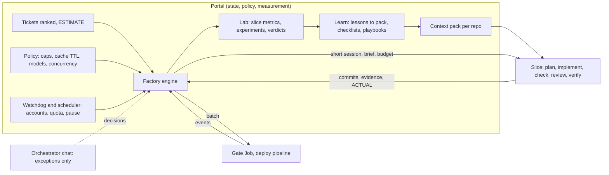

# Token economy and the pilot factory: design v2 (reviewed)

> **Status:** design v2, DRAFT for the owner. **Author:** coordinator. **Last verified:** 2026-10-14 06:55 UTC. **Published copy:** https://docs.isnan.me/doc/token-economy-and-the-pilot-factory-design-for-review-mtvlexI3hs. **Sources:** the portal's usage report and tickets, the raw session tapes in the pod, git, and the scripts in `evidence/` that produced every number. Every claim carries a label: **MEASURED** (from our own tapes or the portal), **MECHANISM** (the behaviour is documented or tested; its effect on us is not yet measured), **HYPOTHESIS** (an experiment decides). v1 of this document (same path, git history) was the first draft; this version is the full review.

## 0. Verdict in short

- The levers of v1 (output caps, the 1 hour sub-agent cache, batching, model by role) are real, but together they give about **1.3 to 1.5× output per dollar**, not "several-fold". A several-fold gain needs **structural** change: no idle time, no rework, no re-exploration per slice, no waiting agents, and the quota of all accounts used. Section 3 gives the multiplier model with every factor labelled.
- Two corrections from fresh data (05:36 UTC): (1) **model by role is not in effect yet** (MEASURED): in the last 12 hours agent runs were opus 60, fable 29, sonnet **0**, although the role files with fixed models exist; the small sonnet cost in the report comes with zero counted requests and zero agent runs, so it is not role dispatch (what it is exactly is unverified). Enforcement has to be verified by the lab every pass, never assumed. (2) The 1 hour sub-agent cache is set but **unverified**: only the Konfersi chat restarted with it; the ClaudePilot chat has not.
- Cost is not the binding limit; **quota is** (plan windows per account and per model). Dollars at list price are the proxy we measure. Productivity therefore has two multipliers: accepted work per quota token, and quota tokens usable per hour (availability and spread across accounts).
- Future-proofing is one principle: **never bind the system to a chat or to a tool version.** State lives in the portal, slices are stateless and disposable, every Claude Code knob sits behind the portal's policy with a version canary, and measurement reads the session stream with a replay corpus.
- The owner decides three things (section 11). Nothing else here needs him.

## 1. The economics

Cost of a session ≈ Σ over requests of (context size × cache-read price) + every new token written once (cache write, 1.25× the input price on the 5 minute cache, 2× on the 1 hour cache) + output. MEASURED shape: cache read about 55 percent, cache write about 32 percent, output about 13 percent. So the bill is **requests × context**, and a tool output is paid for again on every later request of that thread. Three levers move it: fewer requests per unit of work, smaller context per request, a cheaper model per request; a fourth removes work that should not exist (idle, failed, repeated).

| Baseline fact (first 22 h, MEASURED) | Value |
| --- | --- |
| Spend (list price) | $753; $34 per hour, $44 per active hour, peak $82 |
| Model mix by cost | opus 82 percent, fable 17, sonnet 1.4 |
| Resolved tickets | 57 (about $13 to $17 each by allocation); 0 with an estimate, severity or effort |
| Idle wall time | 25 percent (nothing ran 18:30 to 00:00 UTC) |
| Deploys | 19 ClaudePilot deploys, 7 green, 8 cancelled, 4 failed; each restarts the portal |
| Sub-agents vs chats | 79 percent vs 21 percent of cost; 49 percent of the chats' cost is hands-on Bash at 156 to 430 k context |
| A median slice (160 sub-agent runs) | 47 requests, p50 context 77 k, 34 k tokens of tool results, 28 min, 45 Bash calls; cost median $1.7, p90 $9, max $38 |
| Cache re-writes | 65 percent of all cache-write tokens re-wrote context after a miss (sub-agents on the 5 minute TTL) |
| Integrity endings | 6 in 13 h, clustered around portal restarts and deploys; the largest lost session $311 |

**Quota, not dollars.** The portal runs nine plan accounts with session and weekly windows per model. When one account is exhausted a chat must move (D-12, D-39); when all are, nothing runs. So the real unit is "accepted work per quota window", and spreading work across accounts and model windows (opus, sonnet and haiku have separate weekly caps) is a productivity lever in its own right, bounded by pod CPU and cluster Jobs, not by money.

## 2. Review of v1: what holds and what was weak

What holds: the equation; the cost shape; the cache-TTL finding (the largest single leak); the replay method; the charter walls; the pre-registered experiment for RTK; the phased rollout with exit criteria.

What was weak or wrong:

1. **Still chat-centric.** v1 moved the plumbing to code only in "phase 2 on Event". Event is paused now, so the structural change had no vehicle. v2 runs the factory on ClaudePilot itself, which has the richest history to compare against.
2. **Enforcement was assumed.** "Model by role: done" was written while the data show zero sonnet agent runs. A rule without a metric that checks it is a wish. Every rule in v2 has a check the lab runs each pass.
3. **The context model is the real waste.** Each slice re-learns the repository (23 percent of sub-agent Bash is inspection, median 47 requests). v1 withdrew the "context pack" number because the replay could not measure it, which was right, but the lever itself is the strongest structural one and belongs in an experiment, not in the bin.
4. **Rework was unmeasured.** First-pass yield, reopens and the cost of re-built contexts after an integrity ending were not in the metric tree. "Cheaper" without "accepted" can mean "more rejected work".
5. **Agents wait.** Waiting is 6 percent of calls, but an agent that waits on a gate or a deploy holds a context that expires and is re-written. The fix is not a longer cache alone; it is that **no agent waits**: the engine resumes work on events.
6. **The coordinator's own cost** (this VS Code session, now on Fable) is outside every number. The watchdog in the portal (T-259) retires most of it; until then it is an unmeasured overhead.
7. **The learning loop was vague** ("sonnet proposes pull requests"). v2 gives it inputs, outputs and an adoption rule.
8. **Capacity ceilings were missing.** 4 CPUs and 8 GiB in the pod, 3 cluster Jobs at once, node2 at 72 percent CPU, 5,000 GitHub API calls per hour shared by every agent, three portal deploys a day. A plan that scales agents without these numbers scales queues.

## 3. The multiplier model

Output per wall hour at the same spend = (availability) × (first-pass yield gain) × (accepted slices per dollar) × (quota spread), bounded by the ceilings. Each factor is a target with its evidence label and its experiment.

| Factor | Today | Target | Gain | Label | How it is proven |
| --- | --- | --- | --- | --- | --- |
| Availability (share of wall time with work running) | 75 percent | 95 percent | ×1.27 | MEASURED gap | idle hours from the lab, after T-259, T-277, T-255, T-256, T-257, T-270 |
| Rework (re-built contexts, red deploys, reopens, send-backs) | unknown | first-pass yield +10 points, zero re-builds from endings | ×1.15 | HYPOTHESIS | first-pass yield and "tokens re-built after an ending" in the lab |
| Accepted slices per dollar: v1 levers (1 h cache, caps, batching) | 1.0 | 1.33 | ×1.33 | MEASURED by replay; effect to confirm | before and after on the same slice mix (cache TTL split, re-write share) |
| Accepted slices per dollar: model by role, effort by role | 1.33 | 1.5 | ×1.13 | MECHANISM (cost ratio about 12 to 1); not in effect yet | agent runs by model each pass; cost per accepted slice by arm |
| Accepted slices per dollar: context compiler, plan step, diff-only review, no-wait engine | 1.5 | 2.0 to 2.2 | ×1.35 to 1.5 | HYPOTHESIS | experiment E2 (section 5) |
| Quota spread (slices scheduled across all accounts and model windows, bounded by Jobs and CPU) | 2 to 3 accounts hot, 6 idle | all 9 used by projection | ×1.3 to 1.5 | HYPOTHESIS, capacity-bound | quota windows used per hour; Job queue wait |

Compounded: output per hour **about 2× to 4×** at the same spend and **about 2× per dollar**, if the quality terms do not fall. The v1 levers alone stop at about 1.3 to 1.5×. These are the owner's "several-fold", stated as a model whose factors are each falsifiable; the lab's weekly numbers replace the estimates.

**Ceilings** (the plan is only as good as these): pod 4 CPUs and 8 GiB (heavy work leaves it through `job-run`); 3 cluster Jobs at once and 2 per chat; node2 at 72 percent CPU; session windows of about 5 hours per account and weekly windows per model; GitHub API 5,000 calls per hour shared; portal deploys at most three a day; one scratch portal and one Chromium per agent.

## 4. Architecture v2: orchestration as code, judgment as agents

Six layers. Each layer is adoptable on its own and measured by the layer below it.

| Layer | What | Where it lives | Ticket |
| --- | --- | --- | --- |
| 0 Lab | per-slice ingest from the session stream, outcomes, derived metrics side by side, experiments with arms and verdicts, alerts | portal (server + Usage tab + Experiments page) | T-287 |
| 1 Economy controls | output caps, 1 h sub-agent cache, model and effort by role, quota-aware concurrency, deploy batching, gate reuse by sha, compact MCP results, knobs behind policy | portal policy, agent definitions, scripts | T-282, T-285 |
| 2 Context compiler | a generated context pack per repository (map, commands, conventions, gotchas, recent lessons), delivered through the Context pool; a plan step that names files; files preloaded in the implementer's first message | script at merge, Context pool, engine | new (E2) |
| 3 Factory engine | stateless slices run as short portal sessions by code: intake, plan, implement, check, review, verify, integrate, learn; event-driven, no agent waits; the chat orchestrator only for exceptions | portal scheduler (first as a node script run by the supervisor) | new (E3), T-259 |
| 4 Availability and scheduling | watchdog in the portal, recover in place, integrity fix, quota-aware scheduler across accounts, per-session move allowlists, program pause and resume, API-key overflow with a cap | portal | T-259, T-136, T-277, T-273, T-105, D-16 |
| 5 Learning loop | ESTIMATE and ACTUAL, reopens and incidents become lessons; lessons feed the context pack's gotchas, role checklists and templates; playbooks adopted only by experiment; probes | lab + knowledge + kit | T-111, T-113, T-114 |

```mermaid
stateDiagram-v2
  [*] --> Intake: next ranked ticket within WIP, budget, quota
  Intake --> Plan: brief from template + context pack
  Plan --> Implement: file manifest, tests to run (skipped for S)
  Implement --> Check: scripts/slice-check.sh, no model
  Check --> Implement: red, within budget
  Check --> Review: green
  Review --> Verify: diff-only, sonnet; opus for security and migrations
  Verify --> Integrate: independent evidence as files
  Verify --> Implement: send-back (counted as rework)
  Integrate --> [*]: merged, batched deploy, ACTUAL recorded
  Implement --> Escalate: budget exceeded or no written default
  Escalate --> [*]: exception to the orchestrator chat or the owner's checklist
```

Design rules of the engine: a slice is a short portal session with a brief, a request budget and a context budget derived from the ESTIMATE size (S 25 requests, M 60, L 120, XL split); it stops at 150 percent and reports, never silently continues; it never waits (the engine resumes it on the CI event, T-32); its outputs are commits with trailers, evidence files and the ACTUAL comment; its state after the end is only what the portal stored (lineage, tape, metrics). The orchestrator chat handles conflicts, missing defaults and escalations, and its context stays small.

## 5. Lever scorecard

| # | Lever | Label | Effect (input-side unless noted) | Status | Experiment, verdict rule |
| --- | --- | --- | --- | --- | --- |
| 1 | 1 hour prompt cache for sub-agents | MEASURED leak (65 percent of writes re-written), MECHANISM documented in Claude Code 2.1.296 | about 15 percent of the bill (computed) | set (`ENABLE_PROMPT_CACHING_1H=1`, pool `agent-limits`); only Konfersi restarted with it; ClaudePilot chat not yet | E1: TTL split and re-write share on tapes after the restart; adopt if re-write share < 10 percent of writes |
| 2 | Cap tool results (8,000 characters Bash, 5,000 tokens MCP) | MEASURED by replay | 5.7 percent | set | same tapes; fidelity: no missed failure line in 50 sampled capped results |
| 3 | Compact Portal MCP results | MEASURED share (ticket_get 5.5 percent of result characters) | 1 to 2 percent | T-282 | characters per ticket_get call −70 percent |
| 4 | Batch inspection, git-read, api calls; task scripts | MEASURED by replay | 3.1 percent (lower bound) | rules sent; scripts pending | inspection share of Bash calls < 10 percent |
| 5 | Model and effort by role (agent definitions) | MECHANISM; **not in effect** (0 sonnet agent runs in 12 h) | 10 to 15 percent (estimate) | files exist; dispatch not verified | each pass: agent runs by model; verdict on cost per accepted slice and escaped defects by arm |
| 6 | Quota-aware concurrency, deploy batching, gate reuse by sha | MECHANISM | pipeline minutes −30 percent (estimate), fewer endings | rules sent; gate reuse to build | deploys per day, endings per deploy, gate minutes |
| 7 | Context compiler + plan step + preloaded files | HYPOTHESIS (strongest structural lever) | requests per slice −40 percent, cost per accepted slice −25 percent (targets) | to build (E2) | stratified random by slice; adopt at −15 percent cost per accepted slice with yield not down |
| 8 | Factory engine, no-wait, chat as exception handler | HYPOTHESIS | orchestrator share 21 → under 8 percent; idle < 5 percent | to build (E3) | before and after on ClaudePilot; endings that cost work → zero |
| 9 | RTK on Bash output | MEASURED by replay (6 to 9 points on top of caps) | about 6 to 9 percent | T-286 | STEP 1 FAILED 2026-10-14 06:34 UTC (rtk v1.0.0, offline, pinned and checksum-verified): fidelity 0 percent on `node --test` failures (every failing test name and file:line dropped), `rtk err` 40 to 45 percent, `tsc` 100 percent; deny-rule parity: 28 of 70 Bash deny rules bypassed by the rewritten form (all git push rules, kubectl secret reads, /proc environ). REJECTED by the pre-registered stop rules; no hook, no brief rule. A narrow retry (git status, git log, ls only) is a separate, low-ceiling hypothesis for later |
| 10 | Quota spread across accounts and model windows | HYPOTHESIS, capacity-bound | ×1.3 to 1.5 throughput | scheduler in T-259 | quota windows used per hour, Job queue wait |
| 11 | Headroom (proxy compression) | MEASURED by replay (3 to 4 points over RTK) | small | not now | only after 9 and only on a scratch account with a security review |

Withdrawn in v1 and still withdrawn: a rule against short sub-agent runs (3 percent of runs, 0.1 percent of cost). Reinstated as a hypothesis (not as a number): the context pack (lever 7).

## 6. Effectiveness: the right work, finished

Efficiency without effectiveness is cheap waste. Four rules, each with a metric in the lab:

1. **Ticket quality gate.** A ticket is dispatched only with acceptance criteria, an ESTIMATE (size, hours, severity 1 to 4, risks) and a rank tag. Metric: share of dispatched tickets with an estimate (target 100 percent; today 0 of 57 resolved had one).
2. **Flow, not fan-out.** Little's law: lead time = WIP ÷ throughput. Five slices in flight is the cap, thin slices (S and M by default, L split), stop starting and start finishing. Metrics: lead time claim to done, flow efficiency (active time ÷ lead time; six tickets sat 13 to 16 hours waiting for a deploy and a verification), WIP age.
3. **Done means verified by someone else, with evidence a third party can open** (charter). Metrics: first-pass yield, send-backs, escaped defects within 7 days, live tickets waiting for verification (14 at the first evaluation).
4. **Backlog hygiene.** 170 open tickets (83 imported for Event). A weekly sonnet sweep closes duplicates and stale items and checks ranks; the orchestrator works only from the ranked head. Metric: age of the oldest ranked ticket, duplicates found.

## 7. Future-proofing

- **State in the portal, never in a chat.** Tickets, lineage, tapes, metrics, experiments and decisions (T-115 decisions registry, `session_context`) are the memory; any chat can die and nothing is lost. Recover in place (T-136) keeps ids stable.
- **An agent-runner interface.** A slice takes a brief, a budget and a worktree and returns commits, evidence and a report. Today the runner is a Claude Code session (print mode, stream-json). Tomorrow it can be the Agent SDK, the Workflow tool or managed agents; the engine, the lab and the kit do not change.
- **Knobs behind policy with a canary.** Every Claude Code environment variable or setting we rely on (`ENABLE_PROMPT_CACHING_1H`, `CLAUDE_CODE_SUBAGENT_PROMPT_CACHE_TTL`, `BASH_MAX_OUTPUT_LENGTH`, `MAX_MCP_OUTPUT_TOKENS`, sub-agent caps) is delivered by the policy owner (T-285), listed in a compatibility table per Claude Code version, and checked by the version canary (T-21) before a version is pinned. The secrets pool must never carry them (it refuses `CLAUDE_*` names, as found).
- **Measurement from the stream with a replay corpus.** The lab's parser is versioned; the evidence scripts become its regression tests on recorded tapes; a Claude Code format change shows up as a failing test, not as a silent gap. Only aggregates are stored, never content.
- **Vendor-neutral metrics.** Tokens by category (uncached input, cache write by TTL, cache read, output), requests, context, cost at list price. Any model vendor fits the same rows.
- **No hooks that need unattended trust.** Folder trust refuses hooks without a person; compression (RTK) therefore starts as a brief rule, never as a hook, until the policy can deliver hooks safely.
- **The walls stand.** The learning loop may change briefs, skills, templates, model choice, batching and defaults through a normal pull request and gate; never safety rules, deny rules, authz, the Bypass gates, the gates, the thresholds, the scoring or the zero-tolerance list.

## 8. Rollout with exit gates (ClaudePilot first; Konfersi and Event are paused)

| Phase | Content | Exit gate |
| --- | --- | --- |
| 0 (done 2026-10-14) | token discipline, `quiet.sh`, caps, 1 h cache set, role files, quota-aware concurrency, deploy batching, ESTIMATE and ACTUAL comments | this document |
| 1 (this week) | lab v0 (T-287 slice 1: ingest matching the evidence scripts on recorded tapes), compact MCP (T-282), policy env delivery (T-285), gate reuse by sha, role dispatch verified (agent runs by model > 0 sonnet), E1 verdict on the cache | lab numbers equal the scripts on the corpus; sonnet agent runs > 25 percent of runs; re-write share < 10 percent |
| 2 | context compiler and plan step (E2) on ClaudePilot, task scripts, slice budgets; RTK experiment (T-286) | E2 verdict: cost per accepted slice −15 percent, yield not down |
| 3 | factory engine (E3) on ClaudePilot: tickets run as slices by code, chat only for exceptions; watchdog and scheduler (T-259) with quota spread | orchestrator share < 8 percent; idle < 5 percent; endings cost zero work; first-pass yield not down |
| 4 | engine in the portal for every program; resume Konfersi and Event on it; weekly scoreboard (T-114) and learning loop live | weekly report shows the multiplier factors with intervals |

Success metrics, weekly, same sources as the baseline: cost per accepted slice (−35 percent after phase 2, −50 percent after phase 3), requests per slice (−40 percent), p50 context per request (< 80 k), inspection share (< 10 percent), sonnet share of agent runs (> 25 percent), idle hours (< 5 percent), red deploy share (< 15 percent), first-pass yield (up), escaped defects (not up), predictability (ESTIMATE within 1.5× of ACTUAL for 70 percent of tickets).

## 9. Failure modes and how they are detected

| Failure | Detection | Response |
| --- | --- | --- |
| A rule is written but not followed (as model by role today) | the lab reports the metric each pass (agent runs by model, inspection share, ESTIMATE coverage) | fix the dispatch, not the rule; the coordinator escalates after two passes |
| A cap or compression hides a failure line | fidelity audit (sampled plain re-runs, parity of failure sets) | stop the lever at the first incident |
| A smaller context drops a needed fact | the plan step names files; omissions fail the check step, never silently | plan templates learn from the miss (learning loop) |
| A budget stops work too early | the engine stops and reports with the reason; the overrun feeds the scoreboard | raise the size, never discard |
| The engine itself dispatches wrongly | negative-twin tests; independent review of engine changes; audit rows per dispatch | the orchestrator chat as the fallback runner |
| Quota exhausted on all accounts | the scheduler's projection; the usage page | wait and resume (G1), API-key overflow only with the owner's cap |
| Portal deploy ends chats | T-277 hotfix, verify step counts endings per deploy | batching; recover in place |
| Vendor or tool version changes a knob | version canary, compatibility table, replay corpus | pin until adapted |

## 10. Proof ledger

| Claim | Evidence | What would falsify it |
| --- | --- | --- |
| Sub-agents re-write 65 percent of cache-write tokens after misses; their cache is 5 minutes, main chats 1 hour | `evidence/tape_cache_breaks.py`, TTL split (2026-10-14) | tapes after the restart showing the same re-write share with 1 h writes |
| An 8,000 character cap saves about 5.7 percent of input-side cost | `evidence/tape_counterfactual.py` | a new baseline with a different result mix |
| RTK-like compression saves 7 to 15 percent depending on the shrink factor | `evidence/tape_compression_replay.py` | the offline step 1 of T-286 (2026-10-14): the saving is real on git status and ls (0.46 and 0.3 of plain bytes) but the tool failed fidelity and deny parity, so no A/B; rejected |
| Model by role is not in effect | usage report 05:36 UTC: agent runs opus 60, fable 29, sonnet 0 in 12 h | a pass showing sonnet agent runs |
| Idle time was 25 percent of wall time | hourly spend buckets 2026-10-13 | n/a (historical) |
| Median slice: 47 requests, 77 k context, $1.7 | `evidence/slice_metrics.py` (160 slices) | the lab's ingest on the same corpus |
| Context compiler cuts requests per slice by 40 percent | none yet (HYPOTHESIS) | E2 |
| The factory engine cuts the orchestrator share to under 8 percent | none yet (HYPOTHESIS) | E3 |

## 11. Decisions for the owner (defaults in force when silent)

1. **Factory sessions in Bypass.** Slices run as short portal sessions started by the engine, not by a person. D-3 says sessions started over MCP are never Bypass. The engine is the portal itself, so the proposal is a policy switch "factory sessions may run in Bypass under the owner's time-boxed lease (T-104)", off by default, turned on once by the owner, every start audited. This touches a wall (the Bypass gates), so only the owner decides. Default: off; until then slices run through the orchestrator's sub-agents (today's mode).
2. **Phase 2 and 3 on ClaudePilot** (Event is paused). Default: yes.
3. **API-key overflow with a spend cap** when every account is exhausted (D-16). Billing, so a required escalation. Default: off.

## 12. Evidence appendix (reproducible, read only)

All numbers come from the portal's raw session tapes (11,869 assistant messages, 12,582 tool results, 184 threads: 29 sessions plus their sub-agents) and the usage report. Scripts in `docs/dev-sessions/overhaul/evidence/`; run them inside the workspace pod with `kubectl -n isnan-claudepilot-workspaces exec -i <pod> -c workspace -- python3 - < <script>`.

- `tape_counterfactual.py`: caps at 5,000 / 8,000 / 15,000 characters save 8.9 / 5.7 / 2.3 percent of input-side cost; batching consecutive inspection calls 3.1 percent; 155 sub-agent runs, median 49 requests; runs with 8 requests or fewer are 3 percent of runs and 0.1 percent of cost.
- `tape_cache_breaks.py`: cache writes 72.3 M tokens; 47.1 M (65 percent) re-write context after a miss; 46.1 M in sub-agents; the gap before the miss is 5 to 60 minutes (46.5 M tokens), median 10 minutes. TTL split: main chats 5.7 M tokens written, 100 percent 1 hour; sub-agents 66.7 M, 100 percent 5 minutes.
- `tape_compression_replay.py`: RTK-like and Headroom-like compression replayed (section 5).
- `slice_metrics.py`: one line per slice (requests, context p50 and p90, read, write, output units, result characters, re-write tokens, Bash and inspection calls, rtk calls, minutes, ticket); the baseline of section 1.
- Usage report 2026-10-14 05:36 UTC (12 h): $427, requests 198, agent runs 89 (opus 60, fable 29, sonnet 0), cache hit 94.6 percent; the 05:00 bucket spent $74 on 16 requests (large contexts).
- Claude Code 2.1.296 settings schema: sub-agent, workflow, background and helper requests use a 5 minute cache unless `ENABLE_PROMPT_CACHING_1H=1`; `CLAUDE_CODE_SUBAGENT_PROMPT_CACHE_TTL` ("5m" or "1h") takes precedence; the main conversation is automatic, 1 hour on a subscription within its limits.
- Limits: the output share is calibrated, not read from the tapes; cost weights are the standard cache price ratios (read 0.1, write 1.25 or 2.0, output 5); replays do not change what agents would have done; the coordinator's own session is not in the tapes; vendor figures for RTK and Headroom are self-reported.

Sources for RTK and Headroom: [rtk-ai/rtk overview](https://github.com/dauran/rtk), [RTK summary](https://jimmysong.io/ai/rtk/), [headroom-ai on PyPI](https://pypi.org/project/headroom-ai/).
